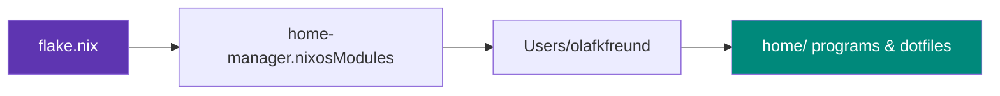

# Home Manager

## The problem

User-space configuration (shell, editors, dotfiles, desktop apps) needs to be
declarative too — but if it is managed *separately* from the system, the two can
fall out of step, and you have to remember to run two different activation
commands.

## The solution

Home Manager is loaded as a **flake module** from `flake.nix`. User environments
are activated **as part of the system rebuild** — there is no separate
activation step.

!!! danger "Do not run `home-manager switch`"
    User environments are built and activated by the NixOS rebuild
    (`just <host>` / `nixos-rebuild switch`). Running `home-manager switch`
    directly will fight the flake-module integration. This is a hard rule for
    this repository.

## How it composes

- **`Users/<name>/`** composes the home configuration for each host from the
  program modules under `home/`.
- **`home/`** contains the actual program configurations (shell, browsers,
  desktop, media, development tooling).

## Why a flake module instead of standalone

- **One activation.** A single `nixos-rebuild switch` brings the system *and*
  the user environment to the declared state together — they can never drift.
- **Shared inputs.** Home Manager sees the same pinned nixpkgs and overlays as
  the system, so versions match.
- **`specialArgs` flow through.** Host variables and feature state are available
  to home modules via `extraSpecialArgs`, so user config can react to the host
  it runs on.

## Adding user configuration

1. Put the program config under `home/`.
2. Compose it for the user in `Users/<name>/`.
3. Rebuild the host — the home generation is activated automatically.
