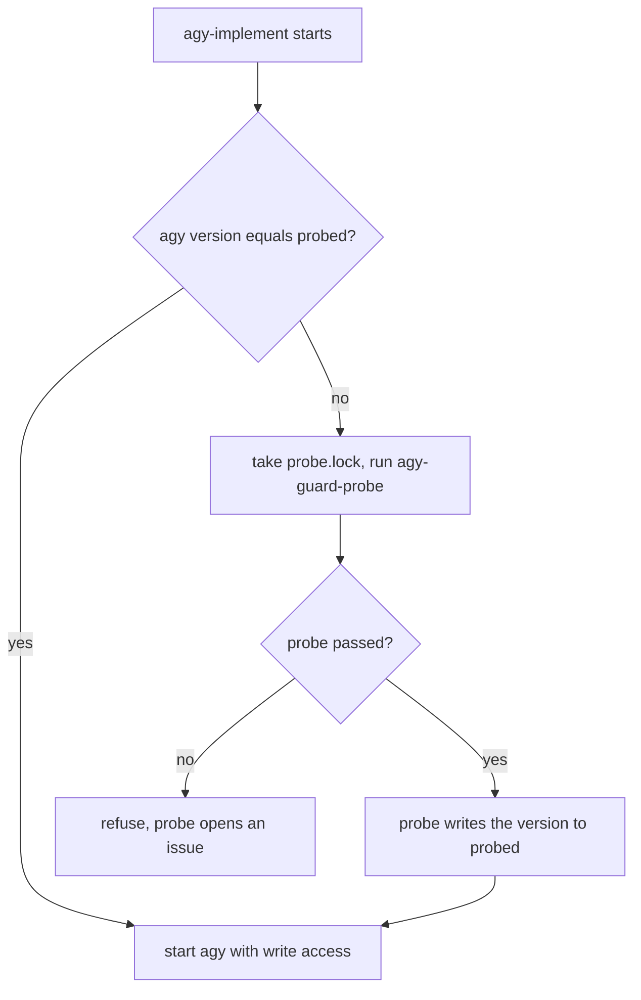

# agy coder guard

`agy-implement` runs the Antigravity CLI (`agy`) with write access, so that it can implement an approved
`plan/` in a task worktree. Under `--dangerously-skip-permissions`, `--sandbox` confines shell commands only;
everything else, file writes included, is fenced by a PreToolUse hook, the **coder guard**. This page
covers what the guard allows and denies, and the version gate that checks the guard still works after an agy
update. Issues: #2087, #2291, #2296, #2298, #2453, #2463.

## What `agy-implement` does

The launcher is defined in `home/development/antigravity-config.nix`. It fails closed. It refuses to start unless:

- `/etc/antigravity/hooks/coder-guard` exists and is executable;
- `~/.gemini/config/hooks.json` registers the `coder-guard` hook exactly as the config declares it;
- the installed agy version has passed the guard probe on this host (see below).

It then starts agy with `--mode accept-edits --sandbox --dangerously-skip-permissions`, a default model, and
`AGY_CODER=1` and `AGY_WORKTREE` set to the current directory. It refuses arguments that could load another
`hooks.json` (`--gemini-dir`, config-dir and config-override flags).

## What the guard allows and denies

The guard is `modules/programs/agy-guard-adapter.sh`. It only acts when `AGY_CODER=1`, so plain agy is
unaffected. It denies by default.

| Tool                                                                      | Rule                                                                                  |
| ------------------------------------------------------------------------- | ------------------------------------------------------------------------------------- |
| `view_file`, `read_file`, `grep_search`, `list_dir`, `find_by_name`, `ask_question`, `list_permissions` | Allowed.                                      |
| `write_to_file`, `replace_file_content`, `multi_replace_file_content`, `write_file`, `edit_file` | Allowed only for absolute, unencoded paths inside `AGY_WORKTREE`. |
| `run_command`                                                             | Passed to the shared coder guard; `BypassSandbox` is denied.                          |
| Any other tool                                                            | Denied.                                                                               |

Denied for every tool:

- any argument that mentions `.gemini`, so a session cannot edit agy's own settings or hooks;
- non-ASCII key names, and duplicate keys compared case-insensitively (agy's Go decoder folds case).

Denied for file writes:

- paths under `.git`, `.claude`, `.envrc`, `.direnv` or `.githooks`, and `.pre-commit-config.yaml` and
  `devenv.nix`, because they run code outside the sandbox;
- hard-linked targets, empty paths and extra string arguments named like a path.

## The version gate and the automatic probe

A new agy version may rename a tool that the guard keys on, which would turn the guard into a silent allow.
`agy-guard-probe` is a live check. In a scratch git repo it asks agy to make one allowed edit and to try five
forbidden actions (a commit, a write to `~/.gemini`, a write outside the repo, a `BypassSandbox` command and a
write to `.envrc`). It passes only if the edit landed, none of the five did, and the guard logged a deny for
each. `agy-implement` therefore compares
`agy --version` with `${XDG_CACHE_HOME:-$HOME/.cache}/agy-implement/probed`.



- The first `agy-implement` on a new version runs the probe by itself. It takes about 90 seconds, so run the
  handoff in the background.
- A `flock` on `probe.lock` stops two parallel starts from probing twice; the second re-checks `probed` after
  it gets the lock.
- Only the probe writes `probed`, and only on a pass.
- An unreadable `agy --version` or a failed probe refuses. agy's `--print-timeout 300s` bounds the probe's run,
  and a start that waits more than 600 seconds for another start's probe lock refuses too.
- The probe ignores the caller's stdin, and a version that changes mid-probe is not recorded.
- The probe's own inner `agy-implement` run sets `AGY_IMPLEMENT_PROBING=1` to skip the gate.
- There is no timer and no activation hook: the probe runs on first use.

## When the probe fails

`agy-implement` refuses and does not start agy. The probe opens a deduplicated issue titled
`agy <version>: coder guard probe failed on <host>`, or prints the title if `gh` is not signed in. Read the
PASS/FAIL lines in the output, fix the guard, and run the probe again:

```bash
agy-guard-probe
```

As an emergency unblock you can write the version into `probed` by hand. **This switches off the check:** agy
then runs with write access and an unverified guard. Do it only when you have confirmed the guard some other way.

```bash
agy --version > "${XDG_CACHE_HOME:-$HOME/.cache}/agy-implement/probed"
```

## Files

- `home/development/antigravity-config.nix`: the `agyImplement` and `agyGuardProbe` scripts.
- `modules/programs/agy-guard-adapter.sh`: the hook adapter, installed at `/etc/antigravity/hooks/coder-guard`.
- `modules/programs/agy-guard-adapter.test.sh`: the guard's test cases.
- `modules/programs/claude-code-managed.nix`: builds the adapter and the shared coder guard.
- `home/development/claude-code-skills/handoff/SKILL.md`: how Claude hands a plan to agy.
- `.claude/commands/update-antigravity.md`: the update procedure.

After an agy update, run the guard tests first:

```bash
bash modules/programs/agy-guard-adapter.test.sh
```

## Known gaps

- The path-argument rule only checks string values whose key contains path or file. A `Destination` or an
  array-valued argument is not covered.
- Some files that run code are not on the deny list: `devenv.local.nix`, `devenv.yaml`, `.mcp.json` and
  `.vscode/tasks.json`. `flake.nix` is allowed on purpose.
- The gate keys on the agy version only. A change to the guard does not force a new probe.
- The probe does not check that a sandboxed `git status` succeeds.
- A symlink race between a parallel `run_command` and a write cannot be closed by a hook. `--sandbox` is the
  control for that.

## History

- #2087: `agy-implement` and the first guard.
- #2291: nothing may touch `~/.gemini`.
- #2296, #2298: write fencing to the worktree under `--dangerously-skip-permissions`, and case-insensitive
  `BypassSandbox`.
- #2453: hardening, `agy-guard-probe`, and the refuse-until-probed gate.
- #2463: the gate runs the probe by itself.
