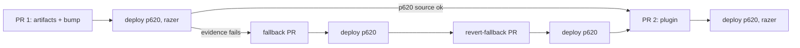

# Plan: bump llm-index to the identity fix and install its shell plugin

Self-contained summary of the approved spec
(`spec/2026-11-15-2962-llm-index-plugin.md`).

## PR sequence

Each PR merges only with green CI after `just validate`.



1. **PR 1 "Refs #2962"**, on `feat/2962-llm-index-plugin` (worktree
   `/home/olafkfreund/.config/nixos-llmidx-plugin`): these artifacts plus
   step 1.
2. **Only if p620's evidence fails:**
   1. the fallback PR (step 2), on `fix/2962-llm-index-adopt`, made from main
      after PR 1 merged;
   2. once `source` is `ok`, a revert-fallback PR (`git revert` of the
      fallback merge), merged and redeployed;
   3. `source` must still be `ok` afterwards.
3. **PR 2 "Closes #2962"** (step 3), on `feat/2962-llm-index-plugin-ui`, made
   from main **only after** p620's `source` is `ok` and any fallback is gone.

## Approved decisions

**Deploy rules:**

- the lead deploys; agents never do;
- from `~/.config/nixos` on main: first `git pull --ff-only`;
- announce on the agent bus, then use `AGENT_BUS_ANNOUNCED=1`;
- p620 with `just p620`, run on p620; then razer with
  `just deploy-via-p620 razer`;
- p510 is never touched.

**Stage 1:** the llm-index input pin only, to
`54e0fbebf8a5ce6ea6ccc3056350eb533a95b0f1`.

**Fallback:**

- `local.llmIndex.sourceAdoptUuid` (`nullOr str`, default `null`), passed
  through as `roots.source.adoptUuid`;
- p620 sets `"bdd8461e-7d6c-42b6-9cfe-39967825dd42"`;
- the whole fallback is reverted once `source` is `ok`.

**Stage 2** goes in `hosts/common/nixos/llm-index.nix`:

- the import, keys and menu entry (step 3 has the exact code);
- the plugin `src` and `enableOnce` inside the HM user;
- `home.packages = [ cfg.package ]` stays (it keeps `llm-index` on the
  session PATH with the default config path);
- no `shell.json` writes from Nix.

**Runtime needs** on both hosts:

- `llm-index` on the shell's PATH;
- `omarchy-launch-floating-terminal-with-presentation`;
- the default Omarchy bar.

## Baselines (recorded 2026-11-15 22:22, before any change)

Saved in the session scratchpad as `baseline-2962.txt`, and copied here:

| Host | Package | `source` | `docs` |
| --- | --- | --- | --- |
| p620 | `/nix/store/lw619q5gni7n8gzxkq8415bcdxysyvmv-llm-index-0.1.0` | `offline` / `identity mismatch`, files 41920, chunks 236442 | `ok`, files 6396, chunks 71145 |
| razer | same store path | `ok`, files 10111, chunks 67947 | `ok`, files 4327, chunks 45019 |

## Steps

The check for steps 1 to 3, from the step's worktree:

```bash
nix build .#nixosConfigurations.p620.config.system.build.toplevel --no-link && nix build .#nixosConfigurations.razer.config.system.build.toplevel --no-link
```

The lead then runs `just validate`. Traps for every step:

- keep the files nixpkgs-fmt and deadnix clean (the pre-commit runs both);
- agents never stage, commit, push, deploy, switch or restart, and never
  work on `main` or in `~/.config/nixos`.

1. **Input bump** in `flake.nix:153` and `flake.lock`.
   - Set the rev to `54e0fbebf8a5ce6ea6ccc3056350eb533a95b0f1`.
   - Run `nix flake lock --update-input nixarchy-llm-index`.
   - `git diff flake.lock` shows only the `nixarchy-llm-index` node changed.

   → verify with the check above, and:

   ```bash
   nix eval --raw .#nixosConfigurations.p620.config.home-manager.users.olafkfreund.services.llm-index.package
   ```

   It gives a store path that isn't the baseline `lw619q5…`.

   Trap: no other input moves.

2. **Fallback, only if p620's evidence fails after stage 1.**
   - In `hosts/common/nixos/llm-index.nix`, add `sourceAdoptUuid` to the
     `options.local.llmIndex` block (lines 9-19), shaped like
     `excludePaths`.
   - Add `adoptUuid = hostCfg.sourceAdoptUuid;` inside `roots.source`
     (around line 36).
   - In `hosts/p620/nixos/nixarchy.nix`, next to
     `local.llmIndex.sourcePath`, set:

     ```nix
     local.llmIndex.sourceAdoptUuid = "bdd8461e-7d6c-42b6-9cfe-39967825dd42";
     ```

   → verify with the check above, and:

   ```bash
   nix eval .#nixosConfigurations.razer.config.home-manager.users.olafkfreund.services.llm-index.roots.source.adoptUuid
   ```

   It gives `null`.

   Trap: this PR is reverted whole once `source` is `ok`.

3. **Plugin wiring** in `hosts/common/nixos/llm-index.nix`.
   - The file has `options.local.llmIndex` at line 9 and
     `config.home-manager.users.olafkfreund` at line 21, as dotted top-level
     attributes.
   - Add `imports = [ ./omarchy-enable-once.nix ];` as a top-level
     attribute.
   - Add these two dotted top-level attributes:

     ```nix
     config.local.omarchy.keys.extra = [
       {
         key = "SUPER + CTRL + ALT + I";
         description = "llm-index";
         action = "omarchy-shell shell toggle olafkfreund.llm-index '{}'";
       }
     ];
     config.programs.nixarchy.menu.extraEntries."apps.llm-index" = {
       icon = "";  # U+F1C0, Nerd Font database glyph
       label = "llm-index";
       description = "Index status and settings · Super+Ctrl+Alt+I";
       aliases = [ "llm-index" "index" "search index" ];
       action = "omarchy-shell shell toggle olafkfreund.llm-index '{}'";
     };
     ```

     This is the same shape as `omarchy-keys.nix:294-301`.
   - Inside the HM user function, next to `home.packages` (line 47), add:

     ```nix
     programs.nixarchy.plugins."olafkfreund.llm-index".src =
       inputs.nixarchy-llm-index.packages.${pkgs.stdenv.hostPlatform.system}.plugin;
     local.omarchy.enableOnce = [ "olafkfreund.llm-index" ];
     ```

     `pkgs` is already an argument of that function.
   - Add one header-comment line about the plugin.

   → verify with the check above, and:

   ```bash
   nix eval --json .#nixosConfigurations.p620.config.home-manager.users.olafkfreund.programs.nixarchy.plugins --apply builtins.attrNames
   ```

   It contains `"olafkfreund.llm-index"`.

   Traps:
   - the keys module fails the build on a duplicate chord;
   - don't touch the MCP registration activation.

## Tests (lead)

**Before stage 2, on each host:**

- `hyprctl binds -j | jq '[.[] | select((.key|ascii_upcase)=="I" and .modmask==76)] | length'`
  gives `0` (p620: `0` on 2026-11-15);
- `shell.json`'s `bar` sets no third-party bar plugin;
- `/proc/<quickshell pid>/environ`'s `PATH` holds a directory with
  `llm-index` and
  `omarchy-launch-floating-terminal-with-presentation`.

**Stage 1, live, on p620, then on razer:**

- `systemctl --user show llm-index -p ExecMainStartTimestamp`, and the
  running binary's store path, are the new ones (not `lw619q5…`);
- `llm-index status`:
  - **p620:** `source` goes `identity check`, then `ok`, with counts close
    to the baselines (files 41920) apart from edits;
  - **razer:** both roots stay `ok` with counts close to the baselines;
- **p620:** a read-only `sqlite3` query of `share_id, fs_uuid` from `roots`
  in `~/.local/state/llm-index/public.db` shows `/dev/sdd1` and
  `bdd8461e7d6c42b69cfe39967825dd42`. On razer, note `fs_uuid`; it may stay
  empty;
- **MCP, from fresh client sessions** (a running session keeps the old
  server):
  - `claude -p`, `codex exec` and `agy -p` each list `llm-index` and return
    a hit;
  - on p620, a public search finds a file changed after 2026-11-14.

**Fallback, if used:**

- p620 reaches `ok` with that UUID;
- razer's `~/.config/llm-index/config.toml` has no `adopt_uuid`;
- after the revert-fallback PR is deployed, `source` stays `ok`.

**Stage 2, live, on p620, then on razer, after a re-login:**

- the plugin is enabled, and the marker
  `${XDG_STATE_HOME:-$HOME/.local/state}/nixarchy-local/enabled-once/olafkfreund.llm-index`
  exists. If the first login missed it (asynchronous rescan), the next login
  retries. Otherwise run `omarchy plugin enable olafkfreund.llm-index`;
- the key and the menu row open the panel;
- the tabs match `llm-index status`;
- Refresh shows the busy marker, then updated data;
- Open log opens a floating terminal on the journal;
- `systemctl --user stop llm-index` gives `down` within 10 s. Restart from
  the panel (keyboard confirm) clears it. If it doesn't,
  `systemctl --user start llm-index`;
- the tooltip and `omarchy-shell olafkfreund.llm-index.bar status` show a
  level only;
- the shell journal has nothing from the plugin;
- a disable in Setup > Plugins survives a re-login; then re-enable it;
- **p620, with the panel open:** sample every 5 s for 2 minutes. Each of
  these stays at most 1:
  - `pgrep -cf 'llm-index status --json --brief$'`;
  - `pgrep -cf 'llm-index status --json$'`;
  - `pgrep -cf 'systemctl --user show llm-index.service'`.

**Reviews:** before each PR, fresh Codex and agy sessions review its diff
against this plan, read-only.

## Rollback

- **Stage 2**, on each host:
  1. disable the plugin first (Setup > Plugins, or
     `omarchy plugin disable olafkfreund.llm-index`);
  2. then revert PR 2, redeploy, and re-login;
  3. delete
     `${XDG_STATE_HOME:-$HOME/.local/state}/nixarchy-local/enabled-once/olafkfreund.llm-index`
     before any later re-deploy.
- **Stage 1:** revert in order, then redeploy and check `llm-index status`
  and fresh MCP sessions:
  1. PR 2, if it landed;
  2. the fallback, if it's still in;
  3. only the step 1 commit (`flake.nix` and `flake.lock`) of PR 1. The
     approved artifacts stay.

  Roots whose new identity was accepted stay `ok`. A `source` that never
  recovered stays `offline`.
