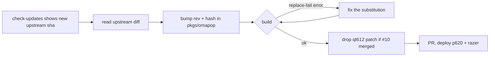

# Spec: omapop selection-bar plugin on p620 and razer

The intent was approved without answers to its three open questions. This
spec takes the defaults below; each one is marked **(default — override at
review)**.

1. **Accessibility probe stays on (upstream default).** The approved outcome
   requires "Cut and Paste only in fields that accept them", which needs the
   probe. It can be switched off at runtime in Settings without a rebuild.
   **(default — override at review)**
2. **No deno.** JavaScript extensions stay listed-but-disabled, which matches
   the intent's "keep the closure small" constraint. **(default — override
   at review)**
3. **Upgrade signal:** a `# Bump against:` comment in the package (the
   omadroid convention), plus one line in `.claude/commands/check-updates.md`
   so that review lists omapop's upstream HEAD next to the pinned rev. No new
   `just` recipe. **(default — override at review)**

## Design

### 1. Package: `pkgs/omapop/default.nix`

Modelled on `pkgs/omadroid/default.nix`: `stdenvNoCC`, `dontBuild = true`, and
`substituteInPlace --replace-fail` for every path. `--replace-fail` is the
upgrade guard: if upstream moves or renames a call site, the build fails
instead of shipping a plugin that quietly loses a tool.

- **Source:** `fetchFromGitHub { owner = "jondkinney"; repo = "omapop"; rev = "7d6b1aa…"; hash = …; }`.
  `version = "0.4.11"`, matching `manifest.json`. The comment above it reads
  `# Bump against: gh api repos/jondkinney/omapop/commits --jq '.[0].sha'`.
- **Patch:** `patches = [ ./qt612-color.patch ];`. This is upstream PR #10
  (head `4bff479`, base `7d6b1aa`, one commit by overp0werj0int), vendored as
  a file, not `fetchpatch`, because a PR head can be force-pushed. I reviewed
  it: it adds `import qs.Commons as OmarchyTheme` to six QML files,
  requalifies `Color.*` as `OmarchyTheme.Color.*`, and touches tests only
  otherwise. It runs no processes and makes no network calls. It applies
  cleanly to `7d6b1aa` (checked with `git apply --check`). Drop it when an
  upstream bump includes #10.
- **Arguments:** `lib, stdenvNoCC, fetchFromGitHub, python3, hyprland,
  util-linux, wl-clipboard, coreutils, xdg-utils, dbus, bash, glib, openssl,
  at-spi2-core, jq`. `hyprland` is overridden by the host
  module (see 2), so the default `pkgs.hyprland` is never used on our hosts.
- **Python:** `py = python3.withPackages (p: [ p.pyyaml p.pygobject3 ]);`
  replaces every `/usr/bin/python3` (10 sites in `Service.qml`, plus
  `bin/omapop-native.py`).
- **Typelib path:** in `bin/omapop-context.py`, before `import gi`, insert
  `os.environ.setdefault("GI_TYPELIB_PATH", "<at-spi2-core>/lib/girepository-1.0:<glib.out>/lib/girepository-1.0")`.
  This is needed because `Service.qml` starts every child with a cleared
  environment.
- **Path substitutions (core runtime):**

  | Upstream | Replacement | Sites |
  | --- | --- | --- |
  | `/usr/bin/hyprctl` | `${hyprland}/bin/hyprctl` | `Service.qml` ×5 |
  | `/usr/bin/setpriv` | `${util-linux}/bin/setpriv` | `Service.qml:457`, `bin/omapop-native.py:34` |
  | `/usr/bin/wl-paste`, `/usr/bin/wl-copy` | `${wl-clipboard}/bin/…` | `Service.qml:457`, `bin/omapop-selection.py`, `bin/omapop-clipboard.py` |
  | `/usr/bin/echo`, `/usr/bin/mkdir` | `${coreutils}/bin/…` | `Service.qml:457,2263` |
  | `/usr/bin/xdg-open` | `${xdg-utils}/bin/xdg-open` | `Service.qml` ×3, `bin/omapop-native.py` ×2 |
  | `/usr/bin/dbus-send` | `${dbus}/bin/dbus-send` | `Service.qml:1540` |
  | `/usr/bin/bash` | `${bash}/bin/bash` | `Service.qml` ×2, `bin/omapop-native.py` ×2 |
  | `/usr/bin/gdbus` | `${glib.bin}/bin/gdbus` | `bin/omapop-context.py:51` |
  | `/usr/bin/openssl` | `${openssl.bin}/bin/openssl` | `bin/omapop_catalog.py:61` |
  | child `PATH: "/usr/bin:/bin"` and `/usr/bin:/bin:/usr/sbin:/sbin` | `/run/current-system/sw/bin:/etc/profiles/per-user/olafkfreund/bin:/usr/bin:/bin` | `Service.qml:58,1796`, `bin/omapop-native.py:32,46` |

  Where a file holds several sites, a substitution may be file-wide
  (`--replace-fail` still fails if none match). The exact line numbers are for
  the plan to pin down.
- **Optional tools left on `/usr/bin`:** deno, node, the browsers, zeal,
  espeak-ng, lp and xdg-terminal-exec. Once the PATH fix is in, envfs
  resolves the ones that are installed and the rest show as unavailable. This
  keeps the closure small.
- **Install:** copy the tree into `$out` except `tests/`, `tools/`,
  `preview.jpg` and `.git*`. `catalog/` and `ports/` are copied byte-for-byte
  because their hashes and signature are checked at runtime.
- **Registration:** `omapop = pkgs.callPackage ./omapop { };` in
  `pkgs/default.nix`, next to `omadroid` (line 57).

### 2. Host module: `hosts/common/nixos/omarchy-omapop.nix`

```nix
{ config, pkgs, ... }:
{
  home-manager.users.olafkfreund.programs.nixarchy.plugins."io.github.jondkinney.omapop".src =
    pkgs.customPkgs.omapop.override { hyprland = config.programs.hyprland.package; };
}
```

- `config.programs.hyprland.package` is the compositor nixarchy runs, the
  same thing `omarchy-sole-hyprland.nix:26` reads. It is not
  `config.programs.nixarchy.package`, which would close the Stylix fixpoint.
- The header comment states the one-time step, `omarchy plugin enable
  io.github.jondkinney.omapop`, and that upgrades are a rev and hash bump in
  `pkgs/omapop`, never `omarchy plugin update`.
- It is imported from `hosts/p620/nixos/nixarchy.nix` and
  `hosts/razer/nixos/nixarchy.nix`, next to the `omarchy-omadroid.nix`
  imports (lines 39 and 38).

### 3. Settings

Nothing is declared. Upstream keeps them in its `shell.json` entry, which
the shell writes at runtime. `extensionDownloads` already defaults to
`false`. `directoryRefresh` defaults to `true`, and the intent requires it
off. It is defaulted in three places, and the package flips all three:

- `Service.qml:170`: `setting("directoryRefresh", true) !== false` becomes
  `setting("directoryRefresh", false) === true`. This is the one that takes
  effect, and it also gates the auto-fetch on an empty catalogue
  (`Service.qml:2355`).
- `manifest.json`, `barWidget.defaults.directoryRefresh` and the schema
  entry's `defaultValue`: set to `false` with `jq` in `installPhase`. The
  schema's `"defaultValue": true` is not unique text, so `substituteInPlace`
  cannot target it. `manifest.json` is not hash-checked; only `catalog/` and
  `ports/` are.

Users can still turn it on in Settings.

### 4. Upgrade flow



`.claude/commands/check-updates.md` gains one line under the pinned-packages
section telling the reviewer to compare `pkgs/omapop` `rev` against
`gh api repos/jondkinney/omapop/commits --jq '.[0].sha'`.

## Alternatives rejected

- **`omarchy plugin add`:** imperative and untracked, and the hardcoded
  paths still break.
- **A `flake = false` input** (the omacards pattern): `nhs` would bump an
  unsandboxed, network-capable plugin without review, which the intent
  forbids.
- **Relying on envfs alone:** children get `PATH=/usr/bin:/bin`, so envfs
  resolves almost nothing, and PyYAML/gi would still be missing.
- **A wrapper that only sets `PATH` and does not substitute paths:** the
  cleared environment drops it.
- **`fetchpatch` for PR #10:** the PR head is mutable. The vendored file is
  reviewed bytes.

## Risks

- **The Hyprland Lua API on our git build (p620 0.56.0-git, razer the
  same input).** The engine uses `hl.bind` (with `non_consuming`,
  `ignore_mods`, `release`), `hl.on("input.keyboard.key")` and `hl.unbind`.
  If one differs, the engine fails to load and the shell logs
  `hyprctl eval said: …`. The app never breaks: no binds are installed.
- **An old engine unbinds mouse:272/273/274 and scroll** (`engine.lua:18`)
  when reinstalling. This removes unmodified binds of other plugins on those
  keys. We have none today (Omarchy's own are SUPER-modified).
- **The session-wide a11y flag** can raise CPU in Electron apps on razer
  (battery). Mitigation: toggle it off in Settings, no rebuild.
- **`pinned_directory` uses `O_NOFOLLOW` from `/`.** It fails if `$HOME` or
  `~/.config` is a symlink. Neither is on these hosts (checked on p620).
- **Node permission flags vs the store symlink:** these only affect JS
  extensions, which stay disabled (decision 2).
- **No upstream tags.** A bump is a judgement call on which commit to take.
  The review step covers it.

## Verification

1. `nix build .#nixosConfigurations.p620.config.home-manager.users.olafkfreund.programs.nixarchy.plugins."io.github.jondkinney.omapop".src`
   or `nix build` of the package via `customPkgs`. Then
   `grep -rn '/usr/bin/' $out --include=*.qml --include=*.py` shows only the
   optional-tool sites listed above.
2. `just test-host p620` and `just test-host razer` (razer via p620), both
   evaluate and build. nixarchy's build-time `omarchy-plugin-validate` passes.
3. Runtime on p620 after deploy and `omarchy plugin enable …`:
   - the shell log has `omapop|ready|5`, with no `hyprctl eval said:` errors;
   - a drag-select in Chrome shows the bar, and Copy, Search and Open Link work;
   - a Shift-select in foot shows the bar; a plain drag in foot does not;
   - the bar icon has theme colours (the Qt 6.12 patch works);
   - the context helper reports editability: Paste is shown in a text field
     and not on page text.
4. Repeat 3 on razer.
5. `~/.config/omarchy/shell.json` for omapop has `directoryRefresh: false`,
   and no popclip.app request appears after 15 s (`ss -tp` or the shell
   log).
